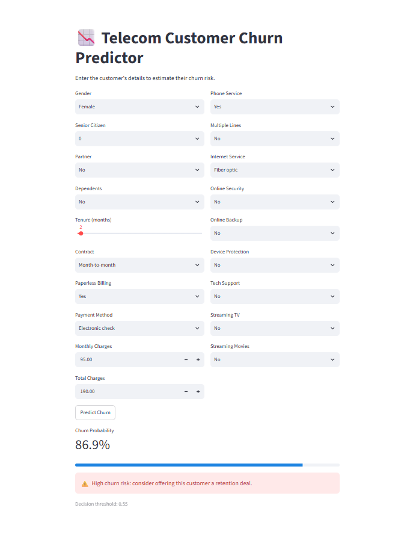
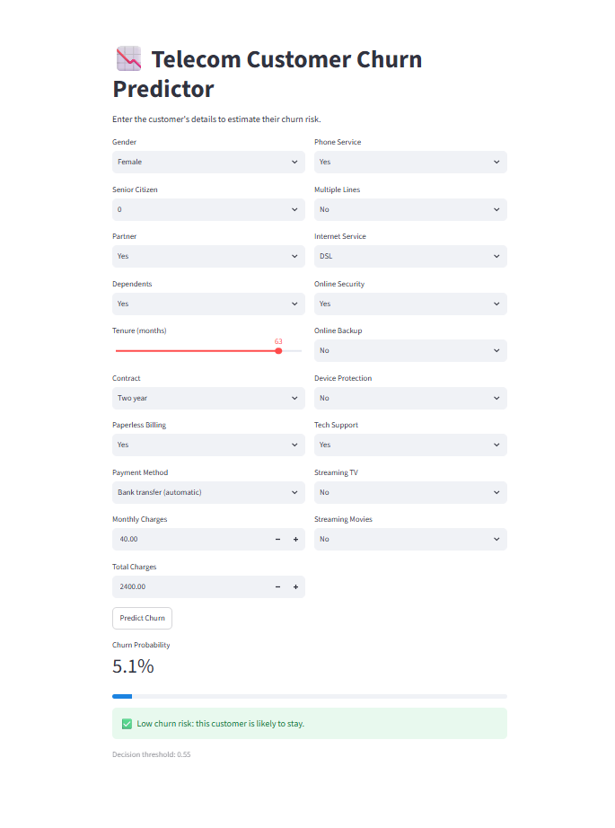
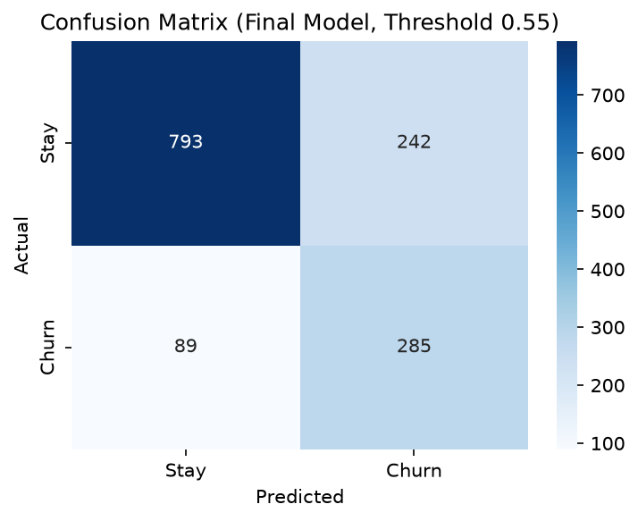
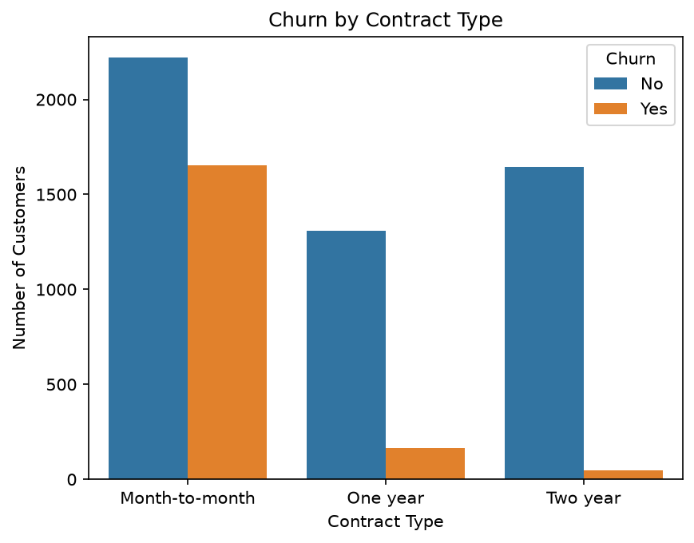
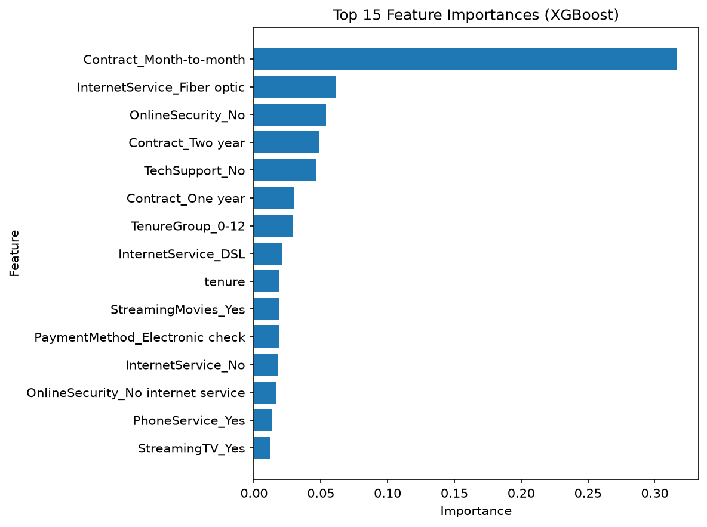

# Telecom Customer Churn Prediction

An end-to-end machine learning project that predicts whether a telecom customer is likely to churn, so the company can offer retention deals in time. The model is deployed as a live web app.

**Live demo:** https://kaish-churn-predictor.streamlit.app

| High-risk customer | Low-risk customer |
|---|---|
|  |  |

## Problem
Losing a customer costs a telecom company far more than keeping one. The goal is to find customers who are likely to leave, with a focus on **high recall** (catching as many churners as possible).

## Dataset
IBM Telco Customer Churn dataset: 7,043 customers and 21 columns (demographics, services, contract, billing). About 26.5% of customers churned, so the data is imbalanced. The CSV is in the `data/` folder.

## Approach
1. Data cleaning and exploratory data analysis
2. Feature engineering (`TenureGroup`, `TotalServices`)
3. Stratified train/test split; preprocessing with `Pipeline` + `ColumnTransformer` (no data leakage)
4. Model comparison: Logistic Regression (baseline), Random Forest and XGBoost, each with and without class weights
5. Hyperparameter tuning (`RandomizedSearchCV`) and decision-threshold tuning on out-of-fold predictions
6. Final evaluation on a held-out test set, feature importance, model saved with `joblib`
7. Streamlit app deployed on Streamlit Community Cloud

## Results
Final model: tuned XGBoost with a decision threshold of 0.55, evaluated on the held-out test set (1,409 customers).

| Metric | Value |
|---|---|
| Recall (churn) | 0.76 |
| Precision (churn) | 0.54 |
| F1 (churn) | 0.63 |
| ROC-AUC | 0.848 |

The model catches 285 of the 374 churners (89 missed). The baseline Logistic Regression catches only 52.7% of churners (recall 0.527).



Model comparison on the test set:

| Model | Precision | Recall | F1 | ROC-AUC |
|---|---|---|---|---|
| Logistic Regression (plain) | 0.661 | 0.527 | 0.586 | 0.843 |
| Logistic Regression (balanced) | 0.507 | 0.797 | 0.620 | 0.843 |
| Random Forest (plain) | 0.662 | 0.497 | 0.568 | 0.842 |
| Random Forest (balanced) | 0.520 | 0.799 | 0.630 | 0.842 |
| XGBoost (plain) | 0.672 | 0.516 | 0.584 | 0.845 |
| XGBoost (weighted) | 0.527 | 0.789 | 0.632 | 0.845 |
| **XGBoost (tuned, threshold 0.55)** | **0.541** | **0.762** | **0.633** | **0.848** |

All three algorithms reach almost the same ROC-AUC, so the differences in recall and precision come mostly from class weights and the decision threshold, not from the algorithm.

## Key Insights
- Customers on **month-to-month contracts** churn at 42.7%, versus 11.3% (one-year) and 2.8% (two-year).
- **New customers** (first 12 months) churn the most (47.4%).
- **Fiber optic** customers churn at 41.9% versus 19.0% for DSL.
- Customers **without Online Security or Tech Support** churn at about 42% versus about 15% for those who have them.




## Run Locally
```bash
git clone https://github.com/kaish-ai/telecom-churn-prediction.git
cd telecom-churn-prediction
python -m venv venv
venv\Scripts\activate        # Windows
pip install -r requirements.txt
streamlit run app.py
```

## Project Structure
```
telecom-churn-prediction/
├── app.py                  # Streamlit app
├── requirements.txt
├── data/                   # Telco churn dataset (CSV)
├── notebooks/
│   └── churn_prediction.ipynb   # full analysis and modelling
├── models/
│   └── churn_model.pkl     # saved pipeline, threshold and columns
└── images/                 # screenshots and graphs used in this README
```

## Limitations
- Feature engineering is replicated in `app.py`; moving it into the scikit-learn `Pipeline` would remove the risk of training-serving skew.
- The models were compared on the test set before the final choice, so the test result is slightly optimistic.
- The decision threshold was tuned on out-of-fold predictions from the same cross-validation folds used for hyperparameter tuning.
- Precision is moderate (0.54): about one in two flagged customers will actually leave.
- The threshold was chosen using F1 and recall, not an actual business cost of a retention offer versus a lost customer.
- The data is a single public dataset, and the findings are associations, not proven causes.

## Tech Stack
Python, pandas, NumPy, Matplotlib, Seaborn, scikit-learn, XGBoost, joblib, Streamlit